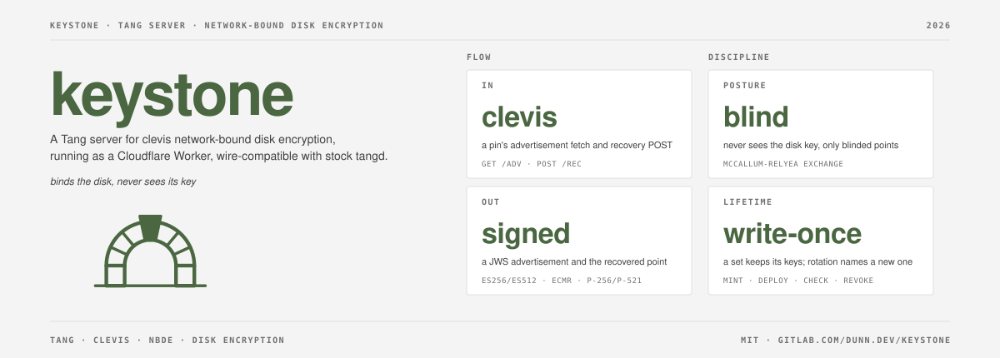

# keystone

keystone is a Tang server for clevis network-bound disk encryption. It runs as a Cloudflare Worker, speaks the protocol of stock `tangd` and serves many named key sets from one deployment. A bound disk unlocks at boot by reaching the Worker over HTTPS. Deleting a set's secret revokes it. `keyset` mints, checks, deploys and revokes the sets.

Shared as-is: no roadmap, no support promise. Report security problems as [SECURITY.md](SECURITY.md) describes.

A `tangd` on your LAN suits hosts that can reach one. keystone is for hosts that cannot.

The design, in figures, is at [keystone.dunn.dev/architecture/](https://keystone.dunn.dev/architecture/).

## Security model

An internet-facing Tang server unlocks a stolen disk from anywhere it can be reached. Revocation is the control, and the origin gate narrows who reaches it.

- `rec` (key recovery) is gated per set. A set with neither `allow` nor `approvers` answers any client, as `tangd` does. A gated set serves origins inside `allow`, holds others until an approver approves by mail, and refuses the rest. `adv` (the advertisement) is public by design and carries only public keys.
- A held host unlocks only because its client keeps retrying, as `clevis-luks-askpass` does. One-shot clients (udisks2, `clevis luks unlock`) just fail.
- Whoever reads an approver's mailbox or Workers Logs holds approval power until a request expires, deny or not. Knowing a set's name lets anyone fill its slots and spend its share of the mail cap; an `allow` edit and the passphrase still work.
- Hosts that egress through WARP or a Worker (AS13335) are always refused by a gated set.
- A revoked set answers 404, and its disks stop unlocking from then on. A host that already unlocked keeps its disk key.
- Private keys live in Worker secrets, which the API cannot read back once written. Any Worker version the account deploys can read them, so whoever controls the Cloudflare account controls the keys. Protect it like the disks.
- Worker versions carry their secrets. A rollback past a revoke serves the revoked set again, and one past a policy edit serves the older policy; `wrangler secret list` shows neither. Never roll back across a revoke or a policy edit. A `null` entry for the set (a tombstone) in the deploy input makes `keyset deploy` detect and drop a revoked set, and `keyset deploy` reports a rolled-back policy as `policy`.
- On the Free plan every request counts toward the daily Workers quota. A flood can exhaust it, and bound hosts fall back to their passphrase until it resets. A WAF rate limit mitigates.
- The unlock alert is a tripwire, not an audit log. Workers Logs records every successful `rec`.
- To split trust, bind with `clevis sss` across keystone and a second server.

## Setup

[docs/setup.md](docs/setup.md) covers install, Cloudflare setup, a first bound disk, rotation, revocation, alerts, the origin gate and the route and key set reference.

## Contributing

See [CONTRIBUTING.md](CONTRIBUTING.md). The GitHub copy is a mirror.
